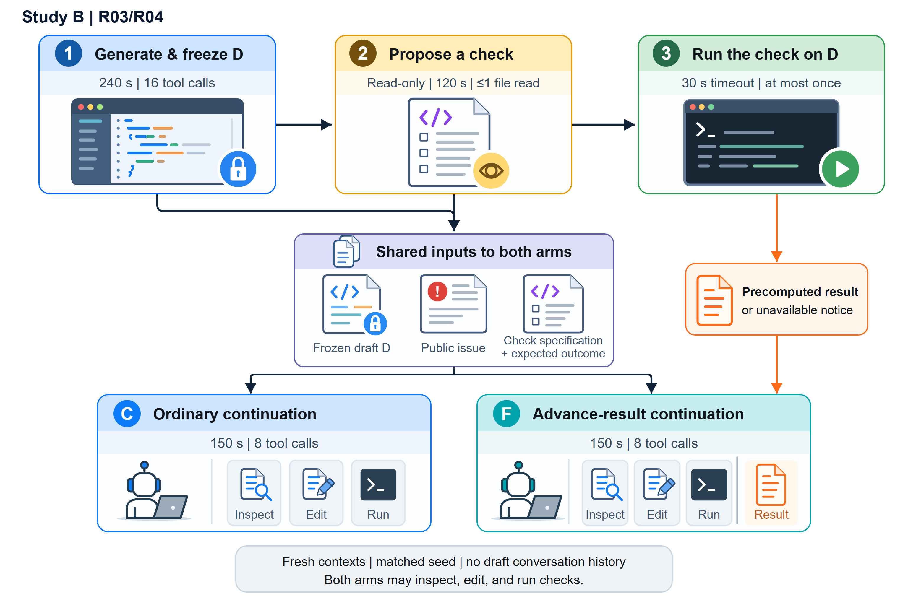
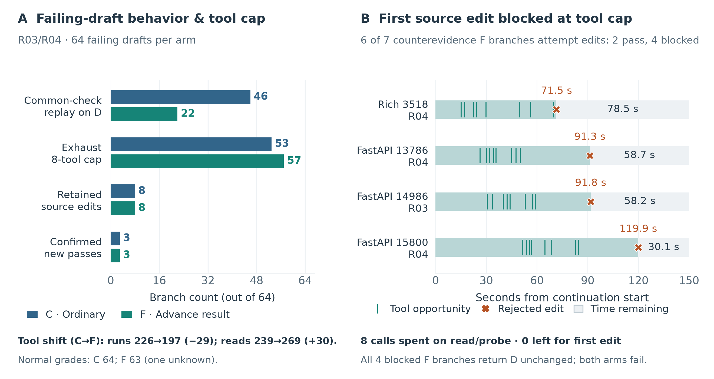

# 主基准图表预览

当前正文使用下面两幅图；三张正文表直接排入[Markdown全文](../manuscript.md)。统一使用蓝色表示普通续修C、绿色表示预给结果F、橙色叉号表示被工具额度拒绝的首次源码编辑。数值来自既有冻结分析。

## 图1：共享初稿与两支续修

[PNG预览](study-design-v04.png) · [可编辑SVG](study-design-v04.svg) · [正式矢量PDF](study-design-v04.pdf)

共享阶段只运行一次。C/F使用新会话、相同初稿、公开问题、检查规格与预期结果，以及匹配seed，均有150秒与八次普通工具机会，两支均可检查、编辑和运行。预先计算的执行结果或不可用通知沿单独的绿色线路交给F。图中预算对应R03/R04最终配置。

图1由[原生SVG生成器](../scripts/build_study_design_svg.py)生成，采用经确认的流程图模板；正文嵌入矢量PDF，Markdown使用3072×2048 PNG预览。PDF文字可检索，含0个嵌入位图；[导出清单](../evidence/study-design-svg-v04.json)绑定SVG、生成器、PNG/PDF和全部可见文字。

## 图2：从检查行为、动作替代到编辑额度墙

[PNG](feedback-and-edit-budget-v04.png) · [SVG矢量版](feedback-and-edit-budget-v04.svg)

左侧使用64个失败初稿分支计数：46/22次初稿重跑、53/57次耗尽8次工具上限、8/8份保留编辑、3/3次确认新通过，并注明工具替代效应（`run_command` $226 \to 197$，`read_file` $239 \to 269$）。C有64个正常结果，F有63个正常结果和一个未知；四行是不同指标。右侧显示七条最终反证（6/7 F分支尝试源码编辑、2/2落地编辑均通过评分）中其余四个被工具上限拦截的案例，各有八次实际工具机会记录。叉号为首源码编辑请求被拒时点，浅灰区为相对150秒预算的剩余时间（30.1–78.5秒）。

## 表格与重建

- 表1覆盖全部108次构造尝试，包括23次没有输出；不把85份输出作为全体分母。
- 表2把C/F拆为独立列，数字右对齐；正常配对数单列，增益/损失明确比较F与C。
- [完整过程表](../supplement/continuation-process-v04.md)保留全部108题次的重跑、源修改、D转移和最终通过。

[构建脚本](../scripts/build_v04_visuals.py)重建图1 SVG并校验仓库中已提供的PNG/PDF；图2继续使用Matplotlib生成PNG与可编辑文字的SVG。[来源清单](../evidence/visuals-v04.json)绑定冻结输入、绘制数据、图内文字与输出哈希。修改图1后的[可选导出流程](../scripts/export_study_design.py)需要Node.js、Playwright/Chromium与pypdf，默认重建不需要浏览器，步骤见[复核指南](../supplement/reproducibility.md)。[主基准重构记录](../review/baseline-rewrite-20261111.md)说明正文重构内容；早期旧图表保存在主项目归档中。
