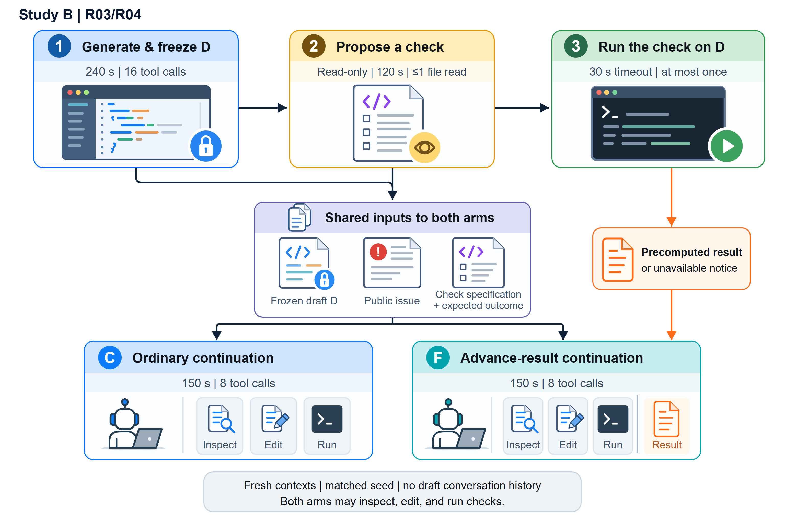

# Knowing the Bug Is Not Landing the Fix: Why Execution Feedback Stalls Before Patch Delivery in Budget-Constrained Coding Agents

**Team xiakongxin**

## Abstract

Test feedback should help coding agents fix more bugs, yet under tight action caps a wide gap separates observing a failure from delivering a fix. Across 3,517 runs and shared-draft realizations in self-hosted Gemma 4 31B on 95 tasks from 15 repositories, we trace where feedback stalls before patch delivery. Reproducing bugs first raises target counterevidence by 54% without improving net passes (75 vs 75). Shared-draft continuations show why: advance check outputs halve replay on failing drafts (72% to 34%) without adding retained edits (8 vs 8) or passes (3 vs 3), as agents trade saved test runs for file reads and 89% hit their eight-call cap. Attrition spans four stages: broken heredoc launches (35% on `python3 -B PY`), reading substitution (with 56 silent line-1 `read_file` resets), cap-blocked first edits in 4 of 6 edit-attempting counterevidence branches (while landed edits pass), and delimiter corruption swallowing `old_string:` in 93 edit calls or draft regressions. Across 2,565 follow-up runs, prompt-only caps, retry rules, and `keep`/`reject` gates fail, motivating runtime edit quotas, resilient tool adapters, and state-bound rollback.

## Introduction

An agent receives failing test output on a buggy draft, inspects the code, and prepares a fix. In Rich3518/R04 and FastAPI13786/R04, it formulates an exact, uniquely matching patch (`highlight=self.highlight` and `self.model.in_.value`); in FastAPI14986/R03 and FastAPI15800/R04, it is still localizing the second file of a two-part change when its eighth call finishes. In three feedback traces (and two controls), the agent hits `BudgetExceeded` at event 8 and emits `edit_file` at event 9—rejected because reading and editing share one pool, with 30–79 s left. Meanwhile, in Rich3067/R03, one branch lands its regex fix and passes, while its twin burns 17 `edit_file` calls after delimiter corruption fuses `old_string:` into `new_string`.

Under realistic time and tool caps, upstream diagnostic gains are absorbed by downstream bottlenecks before a patch lands. We study this gap in Gemma 4 31B QAT across 3,517 runs and realizations on 95 tasks from 15 repositories: whole-workflow repair (736 runs; Study A), shared-draft continuations pairing ordinary (C) and advance-result (F) branches on 54 tasks (216 realizations, 648 endpoints; Study B), and three 855-run prompt-mitigation ablations (2,565 runs). We ask: **RQ1**, where does check construction fail between launch syntax, target reach, and grounding? **RQ2**, when advance results save check runs, how do agents reallocate freed budget, and what blocks diagnosed fixes from landing?

## Related work

**Iterative self-repair.** Self-Repair [1], FeedbackEval [2], and Self-Debugging [3] study feedback in function generation; repository agents instead spend discrete calls on reading, running, and editing under one shared cap.

**Reproduction tests.** SWT-Bench [4], Dynamic Cogeneration [5], and CoHarden [6] generate fail-to-pass tests; we trace how CLI syntax, shared caps, and edit interfaces govern whether test output becomes a delivered patch.

**State-bound repair.** *Looping Is Not Reliability* [7] and Genesis [8] evaluate state-bound repair and acceptance gates; we audit the full natural-draft population, linking each diff to the tool sequence that produced or blocked it.

## Study design

**Model, tasks, and Study A.** All runs use self-hosted Gemma 4 31B QAT on H200 GPUs (RTX 5090 for subagent ablations) (32k context, 4k thinking, 8k output tokens, temperature 0.2, top-p 0.95; `swegemma` 0.2.11, `adk-submission` 0.2.13) across 95 tasks from 15 repositories (54 official, 41 external). Baseline V5 allocates 480 s, 28 calls, 80 turns, and free `submit_patch`. **Study A** (736 runs, three batches) compares V5 against a prompt policy (`v1`) requiring target counterevidence before editing and check replay afterward, plus a reuse-restricted variant (`v2`).

**Shared-draft continuation (Study B) and ablations.** **Study B** evaluates the 54 official tasks (FastAPI 26, Rich 18, Requests 9, HTTPX 1) across four batches (216 realizations, 864 sessions). Each realization generates an unfiltered draft D from V5 (240 s, 16 calls), including empty patches. A read-only constructor receives the issue and D, emits a JSON check and expected outcome, and runs it on D (30 s timeout).

**Figure 1.** Study B shared-draft design. Paired C/F continuations share code, issue text, check specifications, and budgets; only F receives the precomputed result.

Fresh C and F continuations branch from the same D, issue, check specification, and seed without D's history (Figure 1), each receiving 150 s and 8 calls; only F receives the precomputed output. Each path totals 540 s and 26 calls in R03/R04 (R01/R02 cut constructor reads from 3 to 1 and raised time from 60 to 120 s). Three **follow-up ablations** (2,565 runs across 95 tasks) test prompt-capped subagents, schema/shell recovery, and `keep`/`reject` gates.

**Audit protocol.** Scripts extract tool sequences, stderr, `BudgetExceeded` and missing-`old_string` rejections, malformed pagination keys, replay timing, and diffs over D across 216 packets and 432 patches ([reproduction guide](supplement/reproducibility.md)). Annotations were frozen before grading; across 648 endpoints, 620 yield normal grades (five passing empty patches), 25 unknowns, and 3 unscored.

## Results

### Whole-workflow checking boosts confirmation without net repair gains

In Study A, across three batches on the 54 official tasks (162 pairs), `v1` raises pre-edit target counterevidence from V5's 17/14/15 tasks to 27/29/28, and joint counterevidence-plus-replay from 15/11/14 to 20/23/25 (39 to 60 and 37 to 53 on all 95 tasks in R03). Yet confirmed passes tie at 75 vs 75 across 143 normal pairs (27 vs 25, 23 vs 26, 25 vs 26 per batch; seven gains, seven losses; external 29 tasks: 48 vs 47). Probing burns budget (SymPy23950 spends 11 calls before its first edit hits the cap), narrow checks pass on partial fixes (Requests7427), and unverified edits break working code (pytest7205 deletes `saferepr`).

### Stage 1: CLI invocation syntax filters out over a third of generated checks

In Study B's final configuration (R03/R04, Table 1), the constructor emits output in 85 of 108 realizations (up from 21/108 in R01/R02), but only 20 checks reach target behavior with a grounded expectation: 13 match the expectation and 7 expose counterevidence on a failing draft.

**Table 1.** Check-construction outcomes across 108 R03/R04 realizations (54 tasks, two seeds).

| Check-construction outcome | Realizations |
| --- | ---: |
| No execution output | 23 |
| Python invoked on missing `PY` file | 38 |
| Other failure before target behavior | 7 |
| Peripheral behavior only | 9 |
| Target reached; expectation insufficiently grounded | 11 |
| Grounded target behavior | 20 |
| Total attempts | 108 |

The top failure is shell syntax rather than diagnostic logic: **38 of 108 attempts (35%) fail with `can't open file '.../PY'`** on `python3 -B PY`. Attempting an inline heredoc (`python3 -B - << 'PY'`), the constructor omits `- <<`, so Python treats `PY` as a missing file; the rest split into 7 pre-target crashes, 9 peripheral checks, and 11 ungrounded target checks.

### Stage 2: Action substitution and silent read resets absorb saved test calls

Stratifying the 108 R03/R04 realizations by D's grade (40 passing, 64 failing, 3 unknowns, 1 unscored; Figure 2A), advance results on the 64 failing drafts halve replay from **46/64 (72%) in C to 22/64 (34%) in F** (82 to 43 overall), without adding **retained edits** (8 vs 8; 10 vs 9 overall) or **passes** (3 vs 3; two gains, two losses on 63 pairs).

**Figure 2.** R03/R04 failing-draft continuations and counterevidence timelines. (A) Advance results halve replay on 64 failing drafts, but agents trade command runs for file reads. (B) Four counterevidence F branches have their first edit blocked at the cap with 30–79 s left.

Auditing executed calls on the 64 failing drafts shows why: **agents substitute file reading for test execution**. Compared with C, F runs **29 fewer `run_command` calls** (226 to 197) and 11 fewer `get_status` calls (17 to 6), but adds **30 `read_file` calls** (239 to 269; 387 to 328 and 390 to 433 overall). Moreover, **58 executed `read_file` calls across R03/R04 (25 C, 33 F; 24 on failing drafts)** pass a malformed optional key (`"start_line"": "151"`); because `start_line` is optional, the tool ignores it and **silently resets to lines 1–150 in 56 of 58 calls** (24 C, 32 F). Sharing one eight-call pool means **89% of F branches on failing drafts (57/64) and 83% of C branches (53/64) hit `BudgetExceeded`** ([process table](supplement/continuation-process-v04.md)).

**Table 2.** R03/R04 continuations by check quality. Replay counts pre-edit runs on D; edits count retained diffs; gains/losses compare F against C.

| Common result | N | Replay C | Replay F | Retained edits C | Retained edits F | Pairs | F vs C Gains | F vs C Losses |
| --- | ---: | ---: | ---: | ---: | ---: | ---: | ---: | ---: |
| Grounded target | 20 | 20 | 4 | 1 | 3 | 20 | 1 | 0 |
| Other output | 65 | 62 | 39 | 4 | 5 | 62 | 1 | 1 |
| No output | 23 | 0 | 0 | 5 | 1 | 21 | 0 | 2 |

Stratifying by check quality (Table 2) links Stage 1 to Stage 2. In *Other output* (65 realizations, including the 38 `python3 -B PY` crashes), F receives a shell error, forcing **60% (39/65)** of F branches to re-run or repair the check. In *Grounded target* (20 realizations: 10 passing D, 10 failing D), F replay drops **80% (20/20 to 4/20)**, call-0 `read_file` starts jump from **6/20 (30%) to 16/20 (80%)**, and edit-attempting branches double from **4/20 to 8/20**—yet 4 of 8 hit `BudgetExceeded`, leaving 3 retained edits vs 1 in C (+1 pass).

### Stages 3 and 4: The last-centimeter edit wall, delimiter corruption, and draft regression

The seven R03/R04 realizations with grounded counterevidence on a failing draft (eight across all batches, adding FastAPI13537/R02) expose Stages 3 and 4. Whereas 4 of 7 C branches attempt an edit, **6 of 7 F branches (7 of 8 overall) issue a concrete `edit_file` call** across four outcomes:

**1. Landed within cap (2/7 F in R03/R04, 3/8 overall; 100% pass).** Every counterevidence branch executing `edit_file` within the cap passes: Requests6592/R03 in both arms (`too_early` 425 alias at call 2), Rich3067/R03 F (regex fix at call 6 after two schema retries, verified at call 7), and FastAPI13537/R02 F (`processed_keys` in `_extract_form_body` at call 6, verified at call 7).

**2. Exact, uniquely matching fixes preempted by one slot (2/7 F: Rich3518/R04 and FastAPI13786/R04, plus Rich3518/R04 C).** Static verification against D shows both formulate an `edit_file` with an **exact unique match (`occurrences = 1`)** fixing the failing assertion. In Rich3518/R04 (`Column.highlight` not inherited from `Table`), F (event 8, 71.5 s, 78.5 s left) and C (event 9, 44.1 s) emit the identical fix at line 456 of `rich/table.py` (`column = Column(_index=index, highlight=self.highlight)`)—after F lost one slot at event 1 (`"start_line"": "151"`) and C lost two at events 4–5 to silent line-1 resets. In FastAPI13786/R04 (`WWW-Authenticate` formatting `APIKeyIn.query` instead of `"query"`), F verifies the enum bug via `python3 -c`, hits `BudgetExceeded` on `grep` at event 8, and at event 9 (91.3 s, 58.7 s left) emits `self.model.in_.value` on `fastapi/security/api_key.py`.

**3. Multi-part tasks cut off mid-localization (2/7 F: FastAPI14986/R03 and FastAPI15800/R04, plus FastAPI15800/R04 C).** Both require two-file edits (`applications.py` plus `docs.py` or `routing.py`). When `BudgetExceeded` interrupts localization at event 8 (Figure 2B), the model emits a truncated edit on `applications.py` at event 9: FastAPI14986/R03 F emits a bare `old_string` (`"] = True,"` to `"] = False,"`) leaving `docs.py` unedited, while FastAPI15800/R04 F and C overwrite an anchor header (`def include_router(` or `def __init__(`) to insert `def frontend(`.

**4. Cut off at target-file entry (1/7 F: FastAPI15589/R04).** F spends six calls reading `fastapi/params.py` (with a silent `"start_line"": "600"` reset at event 1), locates `convert_underscores` in `fastapi/dependencies/utils.py` via `grep` at events 6–7, and has its first `read_file` on `utils.py` (lines 750–850) blocked by `BudgetExceeded` at event 8 (46.7 s, 103.3 s left).

**Stage 4A: Delimiter corruption and retry loops (93 calls, 11 branches).** Across R03/R04, C and F incur **45 and 48 (93 total, all on failing drafts) `edit_file` rejections** for missing `old_string` across **11 branches** (6 C, 5 F; mean 8.5/branch, peaking at 17 in Rich3067/R03 C and 24 in Rich3718/R04 F). Raw arguments show **in 93 of 93 calls (100%), the model emitted `old_string:`**: when editing code with quotes, colons, or regexes, delimiter corruption fuses `,old_string:` into `new_string`, and in **82 of 93 (88%)** splits target code on colons and commas into bogus keys. Because schema errors do not decrement the cap and report only `old_string` as missing, the model repeats the corrupted call.

**Stage 4B: Continuation regression.** Across all batches, 29 of 432 patches retain executable diffs over D (plus 3 docstrings and 1 restored edit), yet **4 of 29 delete working logic**. Among 40 passing drafts in R03/R04, C retains 40 passes and F retains 39: in Requests7433/R03, F deletes D's passing `hasattr(data, "__iter__")` fallback and hits its cap before restoring it; in Rich3067/R04, F corrupts `highlighter.py` via `sed` and reverts to D while C passes.

## Discussion

Interventions that improve diagnosis—reproducing bugs first (Study A) or supplying precomputed outputs (Study B)—leave solve rates flat because downstream bottlenecks absorb freed capacity. Three 855-run follow-up ablations across 95 tasks and 15 repositories (Table 3) confirm that prompt rules fail without runtime enforcement, motivating three design principles.

**Table 3.** Follow-up prompt-only ablations across 95 tasks from 15 repositories (2,565 runs).

| Prompt mitigation (runs) | Target | Execution behavior | Net solve impact |
| --- | --- | --- | --- |
| Subagent caps (`AgentTool`, 855) | Stages 2–3 pool | 89–96% overrun (med. 21–24 reqs) | 25 vs 19/22 (–9.3/–4.5 pp) |
| Schema/heredoc retry (855) | Stage 4 `old_string` | 3/33 recoveries in R03 (0 pass) | Tie official; –2.4/–5.1 pp ext |
| Voluntary `keep`/`reject` (855) | Stage 4 regression | 23 `keep`, 0 `reject` in 190 runs | +2.0 pp official; –2.4 pp ext |

**Decouple check specification from shell syntax.** Because 35% of R03/R04 checks fail on `python3 -B PY`, forcing 60% of F branches in *Other output* to re-run or repair the check, runtimes should accept a structured Python test body separate from the runner and execute it via a fixed harness.

**Enforce runtime edit reservations over shared pools or soft prompts.** In *Grounded target*, advance results cut replay by 80% and double edit attempts (4/20 to 8/20), yet half hit `BudgetExceeded`. Emitting `edit_file` at event 9 right after an event-8 `BudgetExceeded` (three F, two C traces) proves the agent holds a candidate patch before the cap. Because soft subagent caps overrun in 89–96% of tasks (Table 3), bounded repair requires **runtime-partitioned quotas** reserving the final 2–3 slots for `edit_file` and verification, plus strict key validation on `read_file` so malformed `start_line"` keys warn instead of resetting to line 1.

**Move edit recovery and state-bound acceptance into the runtime.** Because 100% of the 93 missing-`old_string` errors stem from delimiter corruption swallowing `old_string:` into `new_string`, prompt recovery succeeded in just 3 of 33 traces in R03 (Table 3). Tool adapters must reject unrecognized keys, detect swallowed `,old_string:` delimiters, and cap schema retries. Likewise, voluntary `keep`/`reject` prompting yielded 23 `keep` and **0 `reject` calls** in 190 runs [8]: runtimes must bind verification to git hashes and revert regressions over D.

**Scope.** While we fix Gemma 4 31B QAT on Python repositories under competition budgets, shared exploration/edit pools, unvalidated pagination keys, and unrecovered delimiter errors are structural interface properties that penalize any bounded agent ([companion records](supplement/reproducibility.md)).

## Conclusion

Supplying execution feedback to a budget-constrained coding agent changes how it explores, but rarely what it delivers. Across 3,517 runs and realizations in Gemma 4 31B, advance check outputs halve replay on failing drafts, yet agents absorb saved calls into file reads and silent line-1 resets until hitting their cap. When checks expose counterevidence, six of seven feedback branches formulate an edit and every landed edit passes—while four hit the eight-call cap and 93 edit calls fail when delimiter corruption swallows `old_string:`. Across 2,565 follow-up runs, prompt caps, retry rules, and `keep`/`reject` gates fail, showing that turning feedback into fixes requires runtime-reserved edit slots, resilient tool adapters, and state-bound rollback.

## References

1. Theo X. Olausson, Jeevana Priya Inala, Chenglong Wang, Jianfeng Gao, Armando Solar-Lezama. **Is Self-Repair a Silver Bullet for Code Generation?** 2023. Version dated 2 February 2024. [Fixed arXiv version](https://arxiv.org/abs/2306.09896v5).

2. Dekun Dai, MingWei Liu, Anji Li, Jialun Cao, Yanlin Wang, Chong Wang, Xin Peng, Zibin Zheng. **FeedbackEval: A Benchmark for Evaluating Large Language Models in Feedback-Driven Code Repair Tasks.** 2025. Version dated 26 February 2026. [Fixed arXiv version](https://arxiv.org/abs/2504.06939v2).

3. Xinyun Chen, Maxwell Lin, Nathanael Schärli, Denny Zhou. **Teaching Large Language Models to Self-Debug.** 2023. Version dated 5 October 2023. [Fixed arXiv version](https://arxiv.org/abs/2304.05128v2).

4. Niels Mündler, Mark Niklas Müller, Jingxuan He, Martin Vechev. **SWT-Bench: Testing and Validating Real-World Bug-Fixes with Code Agents.** 2024. Version dated 7 February 2025. [Fixed arXiv version](https://arxiv.org/abs/2406.12952v3).

5. Runxiang Cheng, Michele Tufano, José Cambronero, Renyao Wei, Sherry Shi, Grant Uy, Pat Rondon, Franjo Ivančić. **Dynamic Cogeneration of Bug Reproduction Test in Agentic Program Repair.** 2026. Version dated 21 August 2026. [Fixed arXiv version](https://arxiv.org/abs/2601.19066v3).

6. Yuhao Tan, Zhibang Yang, Fangkai Yang, Yuan Yao, Yu Kang, Lu Wang, Pu Zhao, Xin Zhang, Xiaoxing Ma, Qingwei Lin, Saravan Rajmohan, Dongmei Zhang. **Beyond Fail-to-Pass: Iterative Hardening of Co-Generated Bug Reproduction Tests and Fixes.** 2026. Version dated 22 July 2026. [Fixed arXiv version](https://arxiv.org/abs/2607.19843v1).

7. Xueping Gao, Jianwei Yang, Qiang Yang. **Looping Is Not Reliability: State-Bound Evidence and Typed Revision Contracts for Agentic Code Repair.** 2026. Version dated 4 October 2026. [Fixed arXiv version](https://arxiv.org/abs/2607.24604v3).

8. Beichen Huang, Zhenyu Liang, Bowen Zheng, Ran Cheng. **Persistent Recursive Worlds Enable Autonomous Software Evolution.** 2026. Version dated 16 August 2026. [Fixed arXiv version](https://arxiv.org/abs/2608.10450v3).
